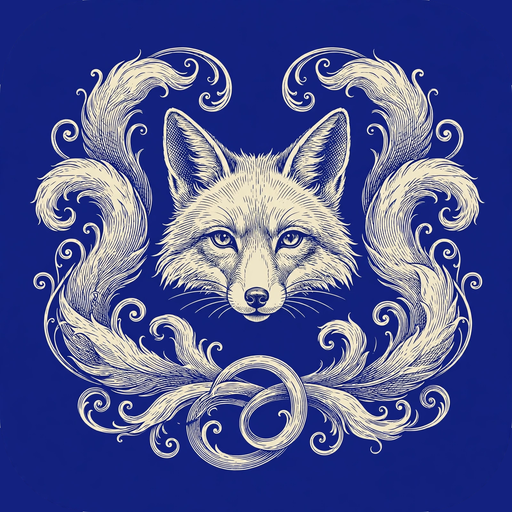

<p align="center">
  
</p>

# PhotoCraft Express

An Android photo editor (Kotlin + Jetpack Compose) whose interface recreates
the Adobe Photoshop Express editor — home photo grid, dark editor chrome,
bottom tool carousel — with entirely original code and hand-drawn icons.

## Credits

The adjustment engine's mathematics follows **PhotoCraft**
([github.com/storytold/photocraft](https://github.com/storytold/photocraft)),
the open-source, clean-room photo editor written in pure Rust by storytold /
the ArtCraft Team and contributors, dual-licensed **MIT OR Apache-2.0**. Its
Levels gamma (with the fitted shadow toe), natural-cubic-spline Curves LUT,
Vibrance pixel model and Saturation grey weights were adapted into Kotlin in
`engine/AdjustMath.kt`; the rest of PhotoCraft was consulted as the reference
for how the operations should behave. Full license texts live in `licenses/`,
and the repo-root `NOTICE` spells out exactly what was consulted vs adapted.

The interface recreates Photoshop Express's layout and flow with original
artwork — no Adobe code, assets or logos. PhotoCraft Express is **not
affiliated with or endorsed by storytold/ArtCraft or Adobe Inc.**

## What works in v0.1.0

- **Home** — app bar with search (filters by file name) and an About/credits
  dialog, a prominent Edit entry (system photo picker), a "jump back in" card
  for the last edited photo, and a grid of the device's photos (MediaStore).
- **Editor** — back, undo/redo, hold-to-compare (shows the untouched
  original), and a prominent Export action, over a centred canvas.
- **Looks** — 14 presets (Vivid, Punch, Warm, Cool, Mono, Fade, Drama,
  Autumn, Golden, Noir, Pastel, Chrome, Breeze, Matte) with live-rendered
  thumbnails from the current photo and a 0–100 intensity slider.
- **Adjust** — expandable slider rows: Exposure, Contrast, Highlights,
  Shadows, Whites, Blacks, Temperature, Tint, Vibrance, Saturation, Sharpen.
  Real per-pixel engine: tone LUT (exposure → contrast → tonal-anchor spline
  curve), per-pixel temperature/tint/vibrance/saturation, unsharp masking.
- **Crop** — aspect chips (Original, Free, 1:1, 4:3, 3:2, 16:9, 9:16, 3:4,
  2:3), rotate 90°, flip H/V, and a free-crop overlay with corner handles,
  move, rule-of-thirds grid and dimmed surround.
- **History** — undo/redo over immutable edit-state snapshots; slider drags
  commit once, on release.
- **Export** — bottom sheet: *Save a copy* renders at full resolution
  (24 MP memory cap) to a JPEG in `Pictures/PhotoCraftExpress` via
  MediaStore; *Share* stages the same render for the share sheet.

## Honestly stubbed

Healing, Effects, Text, Borders and Resize appear in the tool carousel —
dimmed, with a SOON badge — and their panels say plainly that they are not
part of v0.1.0. Nothing pretends to work that doesn't.

## Engine notes

The whole render pipeline is pure Kotlin over raw ARGB pixel arrays
(`engine/PixelPipeline.kt`), so it is covered by JVM unit tests: identity at
defaults, exposure monotonicity, LUT composition, the PhotoCraft vibrance/
levels/curve behaviours, crop geometry and the dihedral remaps that keep the
crop rect correct across rotate/flip. Geometry (rotate/flips/crop) renders
first; then the Look LUT and the Adjust LUT compose into one 256-entry LUT;
then the per-pixel stage (mono blend → temperature/tint gains → vibrance →
saturation); sharpening is an unsharp mask over a three-pass box blur.

## Building

Uses the workspace-local toolchain (JDK 17, Gradle 8.7, Android SDK 35):

```sh
. ~/workspace/tools/env/android-env.sh
./gradlew :app:testDebugUnitTest   # 36 JVM tests
./gradlew :app:assembleDebug       # app/build/outputs/apk/debug/app-debug.apk
```

Package `com.shawnrodis.photocraftexpress`, minSdk 26, targetSdk 35,
version 0.1.0 (versionCode 1).
